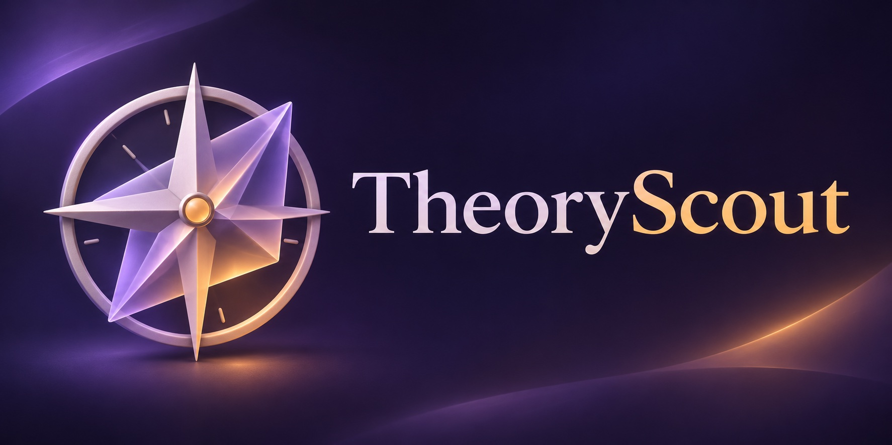

# TheoryScout

**Research prototypes and verification code for exploring theoretical questions.**

## Repository map

- [`F_agent_memory_ratedistortion/`](F_agent_memory_ratedistortion/) — experiment code and selected artifacts
- [`D_optimizer_speedup_phase/`](D_optimizer_speedup_phase/) — experiment code and selected artifacts
- [`tools/`](tools/) — experiment code and selected artifacts
- [`A_muon_logit/`](A_muon_logit/) — experiment code and selected artifacts
- [`B_agent_reliability/`](B_agent_reliability/) — experiment code and selected artifacts
- [`G_testtime_memory/`](G_testtime_memory/) — experiment code and selected artifacts
- [`E_assoc_memory_overcapacity/`](E_assoc_memory_overcapacity/) — experiment code and selected artifacts
- [`H_adamw_timescale/`](H_adamw_timescale/) — experiment code and selected artifacts
- [`pilot/`](pilot/) — experiment code and selected artifacts
- [`QED/`](QED/) — experiment code and selected artifacts
- [`C_retrieval_learnability/`](C_retrieval_learnability/) — experiment code and selected artifacts

## Use

Inspect the relevant script’s module docstring and argument parser before running it. Experiments may require project-specific datasets, model weights and hardware. Recreate those dependencies locally; this release does not bundle them.

Tracks are exploratory research directions and proof/verification prototypes. Their presence here does not imply a theorem is established or an experiment is complete.

## Scope and status

This is a research-code snapshot. Model weights, raw datasets, private operational notes and manuscript files are not included. Recorded results are provided as artifacts, not a claim of independent reproduction or production readiness.

Project artwork was generated with AI for repository presentation.
